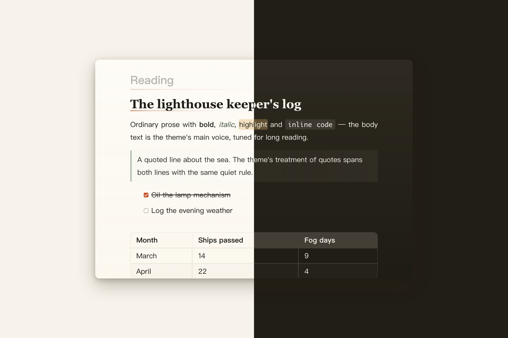
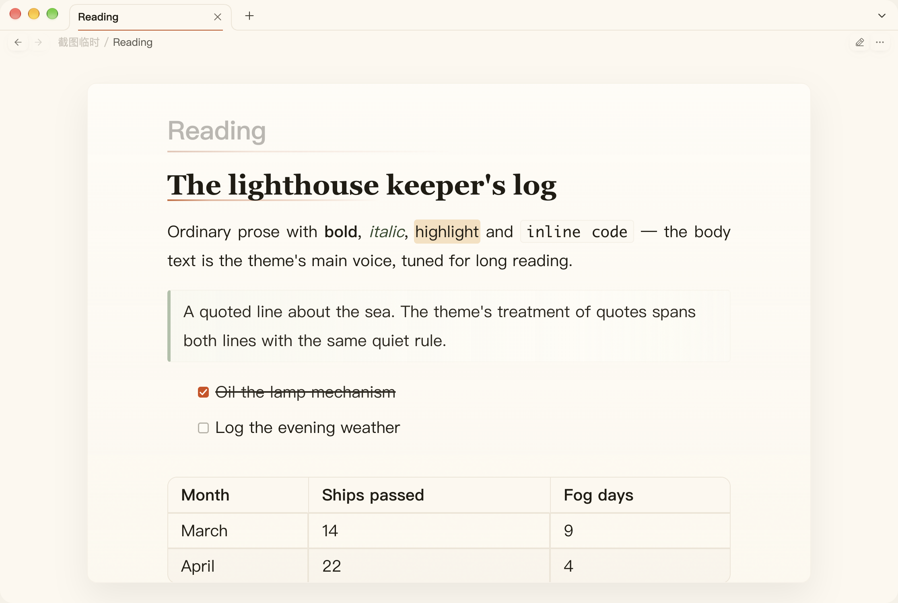
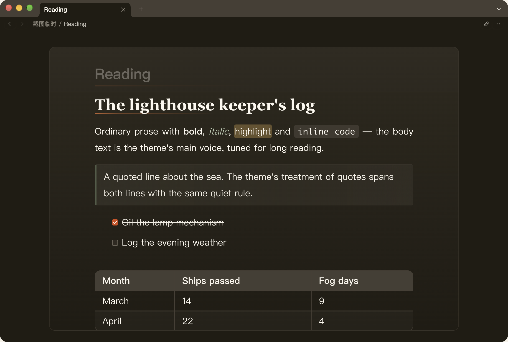
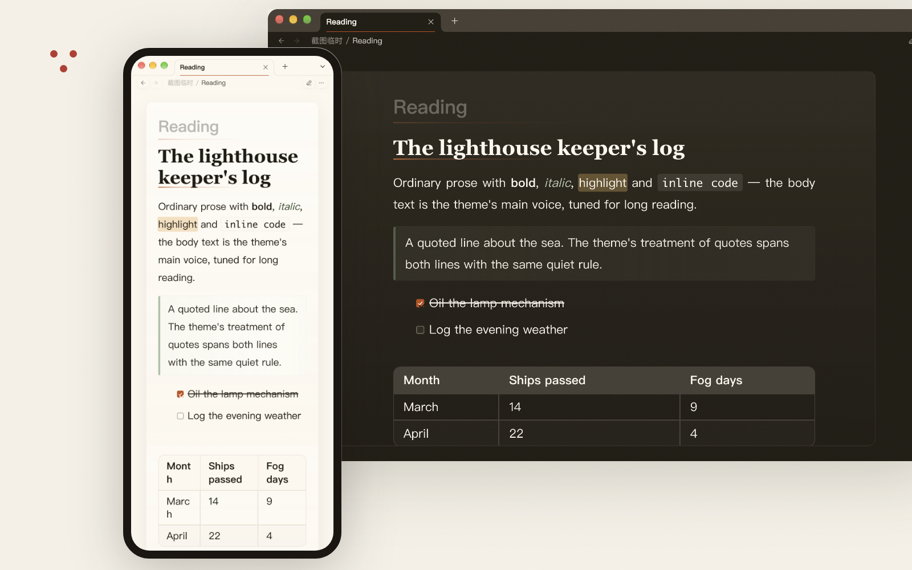

# Scriptorium

_長い思考のための、静かな机。_

[English](./README.md) | [Chinese](./README.zh-CN.md)

  
  
  

長文の読書と執筆のための、温かくミニマルな Obsidian テーマです。

Scriptorium は本文を主役に保ちます。やわらかな紙の色、抑えたコントラスト、静かなワークスペースのクローム、よりフラットなタグと callout、そして CJK とラテン文字の混在ノートに合わせたタイポグラフィを備えています。

紙、光、つながり。Scriptorium は Desk Lamp、Skill Switchboard、Collate と静かな輪郭と視覚リズムを共有します。各製品は独立して動作し、テーマを使うためにプラグインを導入する必要はありません。

## インストール

1. Obsidian の Community Themes で `Scriptorium` を検索します。
2. **Install and use** をクリックします。

手動インストール: `theme.css` と `manifest.json` を `.obsidian/themes/Scriptorium/` にコピーし、Appearance -> Themes で `Scriptorium` を選択します。

## 設計

- Scriptorium は IBM Plex ファミリーで組まれています。[IBM Plex Sans JP](https://fonts.google.com/specimen/IBM+Plex+Sans+JP)、[IBM Plex Serif](https://fonts.google.com/specimen/IBM+Plex+Serif)、[IBM Plex Mono](https://fonts.google.com/specimen/IBM+Plex+Mono) を導入すると自動で適用されます（Google Fonts が利用できない場合は [IBM Plex 公式リリース](https://github.com/IBM/plex/releases)）。
- 外観設定で別のフォントを選ぶとそのフォントが優先され、IBM Plex と CJK フォールバックが続きます。
- モバイルではデスクトップで導入したフォントは使えません。システムフォントがスタックの先頭になり、フォールバックが読み心地を保ちます。
- ドキュメント面は軽く保つ: 画像的な質感、影、アクセント色は意図的に抑えています。
- ナビゲーション、検索、メニュー、タグ、callout、embed は静かに保ち、本文を中央に置きます。
- テーマは単一の `theme.css` として配布され、外部依存も `backdrop-filter` もありません。CI のサイズ予算が軽量さを守り、タイピングは常に機敏です。
- クイックスイッチャー、グラフ、カレンダー、キャンバス、データベース、設定、検索などのインターフェースアイコンと callout アイコンは Phosphor の線言語で描きます。同形のアイコン、プラグインのアイコン、方向記号はネイティブのままです。

| ライトの読書 | ダークの読書 |
| --- | --- |
|  |  |

## カスタマイズ

2 つの opt-in 面と小さな設定パネルがあります。使わなければ表示はバイト単位で同一です。任意の [Style Settings](https://github.com/mgmeyers/obsidian-style-settings) プラグインを導入すると、4 つの読書コントロール（読書行幅、本文の行高、段落間隔、見出し書体）が並びます。ほかの調整は token 契約にあり、安全な上書き層とパレットランプの注釈付きガイドは [snippet-example.css](snippet-example.css) を参照してください。

ファイル単位のヘルパークラスは `cssClasses` frontmatter に書き、自由に組み合わせられます：

| クラス | 効果 |
| --- | --- |
| `cards` | Dataview の表をカードグリッドに（`cards-cols-1/3/4` で列数固定） |
| `row-lines` / `col-lines` / `table-lines` | セルの罫線：行・列・全グリッド |
| `row-alt` | 表の行の縞模様 |
| `table-tabular` | 数値列に tabular 数字 |
| `table-nowrap` | セル内で折り返さない |
| `table-fixed` | 列幅を均等に |
| `table-compact` | 小さく引き締めた表 |
| `wide` | ページと行幅を広げる——横長の表・図・長いコード向け |
| `plain` | 紙の枠、影、見出し下のエディトリアル罫線を外す |
| タスクの `[!]` `[?]` `[>]` `[-]` | セマンティックチェックボックス：琥珀、緑、銅、打ち消し。それぞれ固有の字形（! ? > と空枠）付き——読書とライブプレビュー両方 |

## 削除した変数

カスタムプロパティ 21 個は宣言だけがあり、読み手がありませんでした——このテーマも Obsidian 1.15.1 も読んでいません——ので、2026-11-20 に削除しました。これらを設定していた snippet は以前から効いておらず、今回消えたのは名前だけです。古い snippet を確認しやすいよう、系統別に挙げます：

| 系統 | 削除した変数 |
| --- | --- |
| リンク色 | `--text-link`、`--text-link-hover`、`--text-link-active`、`--text-link-subtle` |
| 二次サーフェス | `--secondary-bg-light`、`--secondary-bg-medium`、`--secondary-bg-strong` |
| メニューの文字 | `--menu-text-color`、`--menu-text-color-hover`、`--menu-background-hover` |
| マーカー色 | `--text-mark`、`--text-mark-subtle`、`--text-mark-strong` |
| 反転サーフェス | `--background-inverse` |
| 検索クリアボタン | `--search-clear-button-color-hover` |
| 見出しの罫線 | `--title-rule-color` |
| スクロールバー | `--scrollbar-size` |
| テーブル見出し | `--table-header-bg` |
| リンク hover の別名 | `--text-a-hover` |
| ハイライト背景 | `--text-highlight-bg-active` |
| ハイライトのインク | `--highlight-color` |

マーカー色の 3 つは別名で、本体は残っています：`--highlight`、`--highlight-subtle`、`--highlight-strong` がハイライト文字の色階を、`--text-highlight-bg` が背景を持ちます。

## プラグイン対応

構造的な揃えのみ——[Dataview](https://github.com/blacksmithgu/obsidian-dataview) と [Quiet Outline](https://github.com/guopenghui/obsidian-quiet-outline) のペインとカードはテーマの面と罫線を引き継ぎます。再配色も再レイアウトもしません。

## 開発

可読ソースは `src/theme.css` にあり、調整可能なものはすべて冒頭のトークン契約に懸かっています（注釈付きツアーは [snippet-example.css](snippet-example.css) を参照）。コード面のセレクタはペアで書きます——CodeMirror `.cm-*` と Prism `.token.*` が同じトークンを指す形です。面を追加するときはこの形をどうぞ。

`src/theme.css` を編集した後は、次の検証・ビルドスクリプトを実行してください：

- `npm run lint` —— `src/theme.css` に stylelint を実行
- `npm run build` —— esbuild で `src/theme.css` を圧縮し `theme.css` を生成
- `npm run check:css` —— `@settings` 宣言の維持、余分なコメントがないこと、160 KiB 予算内であることを検証
- `npm run audit:contrast` —— ライト/ダーク両チェーンを解決し、WCAG しきい値を下回る組み合わせがあれば失敗

Created by [@ouatis](https://github.com/ouatis/). Inspired by [Sanctum](https://github.com/jdanielmourao/obsidian-sanctum) and [Baseline](https://github.com/aaaaalexis/obsidian-baseline).
