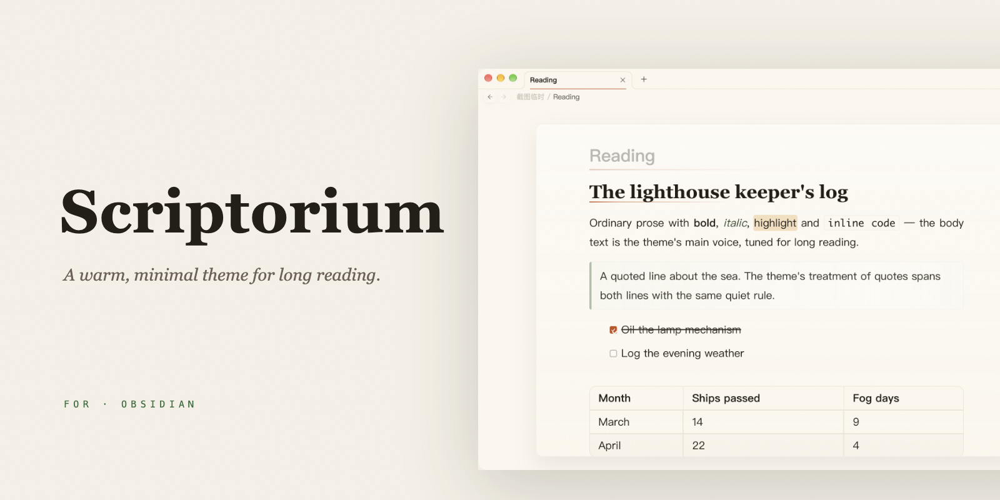
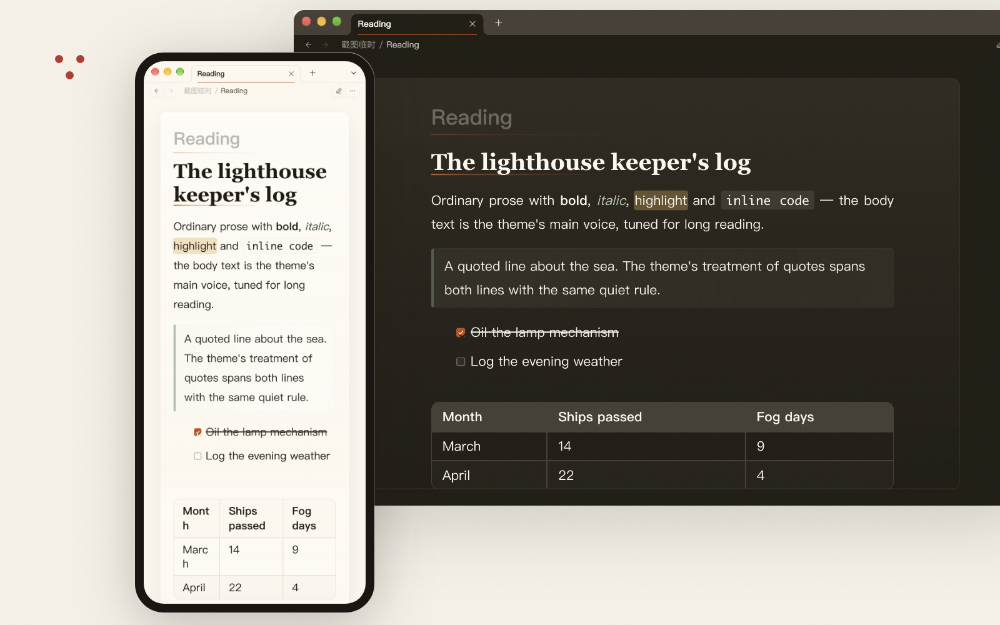

# Scriptorium

_A quiet desk for long thoughts._

[Chinese](./README.zh-CN.md) | [Japanese](./README.ja.md)

  
  
  

A warm, minimal Obsidian theme for long-form reading and writing.

Scriptorium keeps the writing surface primary: soft paper tones, restrained contrast, quiet workspace chrome, flatter tags and callouts, and typography tuned for mixed CJK and Latin notes.

Paper, light and connections: Scriptorium shares quiet shapes and a visual rhythm with Desk Lamp, Skill Switchboard and Collate. Each product works independently; the theme does not require any of the plugins.

> [!NOTE]
> Scriptorium is a personal aesthetic. With the optional [Style Settings](https://github.com/mgmeyers/obsidian-style-settings) plugin, four reading controls appear: reading line width, prose line height, paragraph spacing, and the heading typeface. Everything else lives in the token contract (see [snippet-example.css](snippet-example.css)) and in per-file helper classes.

## Install

1. Search for `Scriptorium` in Obsidian Community Themes.
2. Click **Install and use**.

Manual install: copy `theme.css` and `manifest.json` into `.obsidian/themes/Scriptorium/`, then select `Scriptorium` in Appearance -> Themes.

## Design

- Scriptorium is drawn in the IBM Plex family — install [IBM Plex Sans](https://fonts.google.com/specimen/IBM+Plex+Sans), [IBM Plex Serif](https://fonts.google.com/specimen/IBM+Plex+Serif) and [IBM Plex Mono](https://fonts.google.com/specimen/IBM+Plex+Mono) (or the [full IBM Plex release](https://github.com/IBM/plex/releases)) and they apply automatically.
- Set a different font in Appearance and your choice leads the stack; IBM Plex and the CJK fallbacks follow.
- On mobile, installed fonts don't travel — the system fonts lead the stack and the reading stays comfortable on them.
- Document surfaces stay light: texture, shadow, and accent color are deliberately restrained.
- Navigation, search, menus, tags, callouts, and embeds stay quiet so prose remains central.
- The theme ships as a single `theme.css` with no external dependencies.
- Interface chrome icons (quick switcher, graph, calendar, canvas, database, settings, search and more) and callout icons are drawn in the Phosphor line language; same-shape icons, plugin icons and directional glyphs stay native.

## Design Principles

Guidelines the theme is edited against, kept for future maintenance:

- Keep the warm paper palette restrained.
- Keep the surface clean enough that texture supports the page instead of competing with it.
- Prefer typographic hierarchy over heavy chrome.
- Keep auto-hide behavior limited, predictable, and easy to ignore when reading.
- Use accent colors carefully when they carry semantic meaning in body-sized text.
- Keep callouts, embeds, and floating UI aligned with the same material language, but avoid making routine operational UI feel like stacked cards.
- Keep tags quiet enough to annotate prose without competing with headings or links.
- Treat reading comfort as more important than decorative novelty.

## Customization

Two opt-in surfaces and a small settings panel — notes render identically without them. With the [Style Settings](https://github.com/mgmeyers/obsidian-style-settings) plugin installed, four reading-critical controls appear: reading line width, prose line height, paragraph spacing, and the heading typeface. Everything else adjustable lives in the token contract; [snippet-example.css](snippet-example.css) is the annotated tour.

Per-file helper classes go in the `cssClasses` frontmatter key and compose:

| Class | Effect |
| --- | --- |
| `cards` | Dataview tables become card grids (`cards-cols-1/3/4` fixes columns) |
| `row-lines` / `col-lines` / `table-lines` | Cell borders: rows, columns, full grid |
| `row-alt` | Striped table rows |
| `table-tabular` | Tabular figures for numeric columns |
| `table-nowrap` | No wrapping in cells |
| `table-fixed` | Equalized column widths |
| `table-compact` | Smaller, tighter tables |
| `wide` | Wider page and line measure — for wide tables, diagrams, and long code |
| `plain` | Drops the paper frame, its shadow, and the editorial rules under titles |
| `[!]` `[?]` `[>]` `[-]` in tasks | Semantic task markers: amber, green, copper, and struck-muted chips, each with its own glyph (! ? > and an empty box) — in reading and live preview |

## Plugin support

Structural styling only — panes and cards from [Dataview](https://github.com/blacksmithgu/obsidian-dataview) and [Quiet Outline](https://github.com/guopenghui/obsidian-quiet-outline) inherit the theme's surfaces and borders. No plugin is re-colored or re-laid-out.

## For theme builders

Everything adjustable hangs off the token contract at the top of `src/theme.css`; [snippet-example.css](snippet-example.css) is the annotated tour of the safe override tiers. New colors land as tokens and pass the contrast audit — `npm run audit:contrast` resolves both mode chains and fails under WCAG thresholds (the syntax palette in 0.20.0 shipped this way). Code-face selectors are written as pairs — CodeMirror `.cm-*` and Prism `.token.*` over the same tokens; copy that shape when adding a surface.

## Development

The readable source lives in `src/theme.css`. Edit it, then run `npm run build` — esbuild minifies it into the shipped `theme.css`, which keeps the file lean for the community-store size check. `npm run lint` runs stylelint against the source, and `npm run audit:contrast` resolves the token graph in both modes and fails when a text/surface pair drops under its WCAG threshold.

Personal adjustments go through CSS snippets — [snippet-example.css](snippet-example.css) is a commented tour of the tokens a snippet may safely touch, with the palette ramps and the override tiers explained.

Created by [@ouatis](https://github.com/ouatis/). Inspired by [Sanctum](https://github.com/jdanielmourao/obsidian-sanctum) and [Baseline](https://github.com/aaaaalexis/obsidian-baseline).
