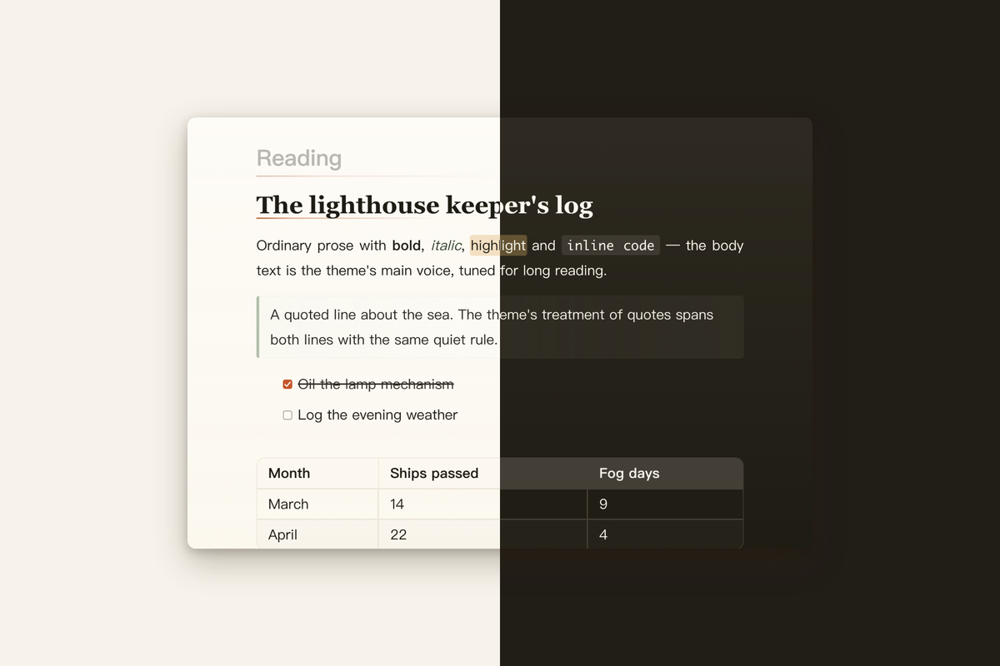
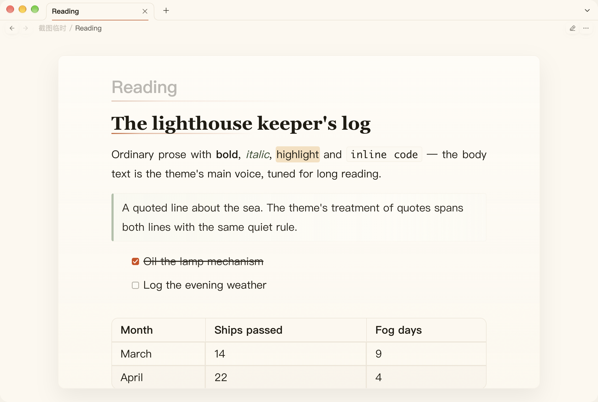
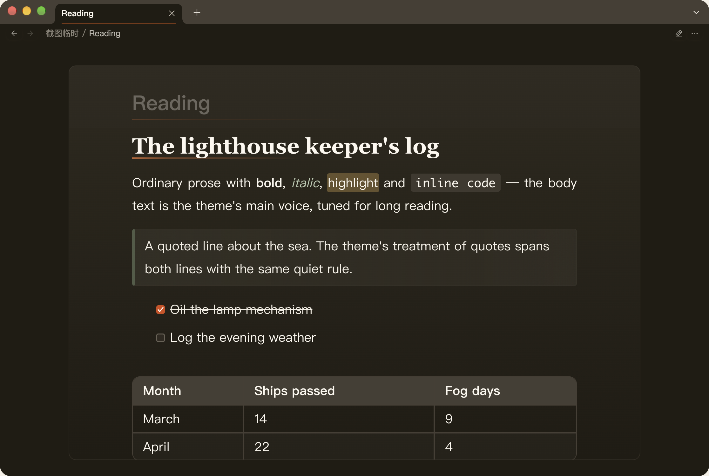
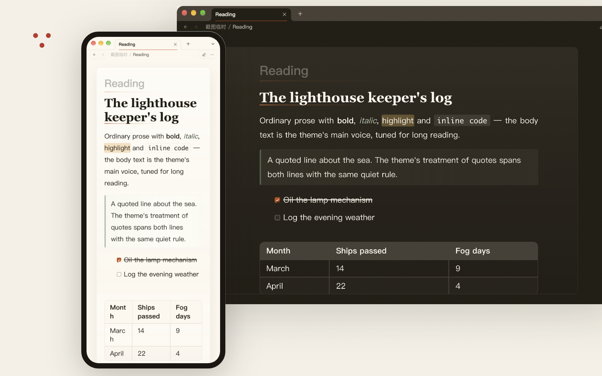

# Scriptorium 主题

_一张安静的书桌。_

[English](./README.md) | [Japanese](./README.ja.md)

  
  
  

一款温暖、简洁的 Obsidian 主题，面向长文阅读与写作。

Scriptorium 让正文保持主位：柔和纸色、克制对比、安静的工作区界面、更平的标签与 callout，以及针对中英文混排调过的字体层级。

纸页、光与连接：Scriptorium 与小台灯、技能接线台、比稿（Collate）共享安静的轮廓和视觉节奏。四件产品各自独立，使用主题不需要安装任何插件。

## 安装

1. 在 Obsidian 社区主题中搜索 `Scriptorium`。
2. 点击“安装并启用”。

手动安装：将 `theme.css` 和 `manifest.json` 放入 `.obsidian/themes/Scriptorium/`，再在“外观 -> 主题”中选择 `Scriptorium`。

## 设计

- Scriptorium 以 IBM Plex 家族排印——安装 [IBM Plex Sans SC](https://fonts.google.com/specimen/IBM+Plex+Sans+SC)（中英混排）、[IBM Plex Serif](https://fonts.google.com/specimen/IBM+Plex+Serif) 与 [IBM Plex Mono](https://fonts.google.com/specimen/IBM+Plex+Mono) 即自动生效；Google Fonts 不可达时可用 [IBM Plex 官方发布包](https://github.com/IBM/plex/releases)。
- 在外观设置里选择自己的字体会领先字体栈，IBM Plex 与中文回退紧随其后。
- 移动端装不了桌面字体，字体栈由系统字体领先，回退链保证手机上的阅读依然舒适。
- 阅读面保持轻：纹理、阴影和强调色都刻意压低。
- 导航、搜索、菜单、标签、callout 和 embed 尽量安静，让正文居中。
- 主题以单一 `theme.css` 发布，无外部依赖、无 `backdrop-filter`；CI 体积预算守住轻量，打字始终跟手。
- 主界面常用图标（快速切换、图谱、日历、白板、数据库、设置、搜索等）与 callout 图标以 Phosphor 线稿绘制；同形图标、插件图标与方向微符保持原生。

| 亮色阅读 | 暗色阅读 |
| --- | --- |
|  |  |

## 定制

两个 opt-in 入口和一个小设置面板；不用时渲染逐字节一致。安装可选的 [Style Settings](https://github.com/mgmeyers/obsidian-style-settings) 插件后，面板会暴露 4 个阅读控件：阅读行宽、正文行高、段落间距、标题字体栈。其余可调项都在 token 契约里，安全覆盖层级与色阶斜坡的带注释导览见 [snippet-example.css](snippet-example.css)。

按文件的 helper classes 写进 `cssClasses` frontmatter，可自由组合：

| 类名 | 效果 |
| --- | --- |
| `cards` | Dataview 表格变卡片网格（`cards-cols-1/3/4` 固定列数） |
| `row-lines` / `col-lines` / `table-lines` | 单元格边线：行、列、全网格 |
| `row-alt` | 表格隔行条纹 |
| `table-tabular` | 数字列用等宽数字 |
| `table-nowrap` | 单元格不换行 |
| `table-fixed` | 等宽列 |
| `table-compact` | 更小更紧的表格 |
| `wide` | 更宽的页面与行宽——给宽表、图表和长代码用 |
| `plain` | 去掉纸张边框、投影与标题下的编辑线 |
| 任务语法 `[!]` `[?]` `[>]` `[-]` | 语义复选框：琥珀、苔绿、铜橙、删除线淡墨，每种各有自己的字形（! ? > 与空框）——阅读与实时预览都生效 |

## 已移除的变量

有 21 个自定义属性只有声明、没有任何读取方——主题自身不读，Obsidian 1.15.1 也不读——已于 2026-11-20 移除。写过这些名字的 snippet 早就不生效，这次只是把名字清掉。按族列出，方便核对旧 snippet：

| 族 | 已移除 |
| --- | --- |
| 链接色 | `--text-link`、`--text-link-hover`、`--text-link-active`、`--text-link-subtle` |
| 次级表面 | `--secondary-bg-light`、`--secondary-bg-medium`、`--secondary-bg-strong` |
| 菜单文字 | `--menu-text-color`、`--menu-text-color-hover`、`--menu-background-hover` |
| 标记色 | `--text-mark`、`--text-mark-subtle`、`--text-mark-strong` |
| 反相表面 | `--background-inverse` |
| 搜索清除按钮 | `--search-clear-button-color-hover` |
| 标题分隔线 | `--title-rule-color` |
| 滚动条 | `--scrollbar-size` |
| 表头 | `--table-header-bg` |
| 链接 hover 别名 | `--text-a-hover` |
| 高亮背景 | `--text-highlight-bg-active` |
| 高亮墨色 | `--highlight-color` |

标记色三个只是别名，本体仍在：`--highlight`、`--highlight-subtle`、`--highlight-strong` 仍然承载高亮文字的色阶，`--text-highlight-bg` 仍然是高亮背景。

## 插件适配

只做结构性对齐——[Dataview](https://github.com/blacksmithgu/obsidian-dataview) 与 [Quiet Outline](https://github.com/guopenghui/obsidian-quiet-outline) 的面板与卡片继承主题的表面与边线，不重新着色、不重新排版。

## 开发

可读源码在 `src/theme.css`，所有可调项挂在文件顶部的 token 契约上（完整导览见 [snippet-example.css](snippet-example.css)）。代码面选择器成对书写——CodeMirror `.cm-*` 与 Prism `.token.*` 指向同一组 token；新增表面时照这个形状抄。

修改 `src/theme.css` 后，运行以下脚本构建与校验：

- `npm run lint` —— 对 `src/theme.css` 运行 stylelint
- `npm run build` —— 使用 esbuild 将 `src/theme.css` 压缩生成 `theme.css`
- `npm run check:css` —— 校验 `@settings` 声明保留、无多余注释，且产物在 160 KiB 体积预算内
- `npm run audit:contrast` —— 解析亮暗两套令牌链，任一对文本/表面组合跌破 WCAG 阈值即失败

由 [@ouatis](https://github.com/ouatis/) 制作。受 [Sanctum](https://github.com/jdanielmourao/obsidian-sanctum) 与 [Baseline](https://github.com/aaaaalexis/obsidian-baseline) 启发。
