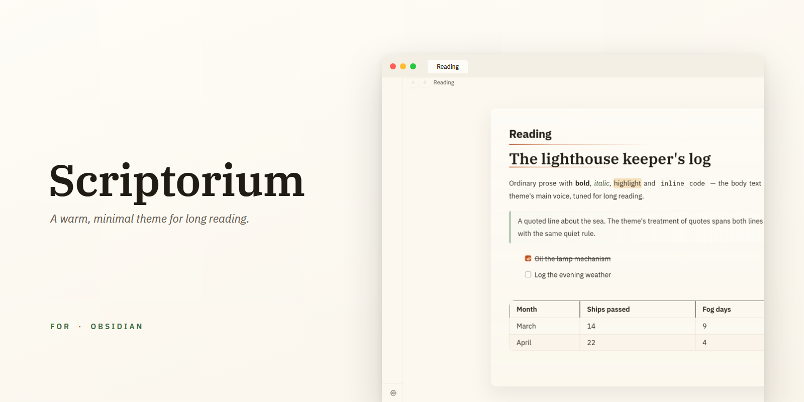
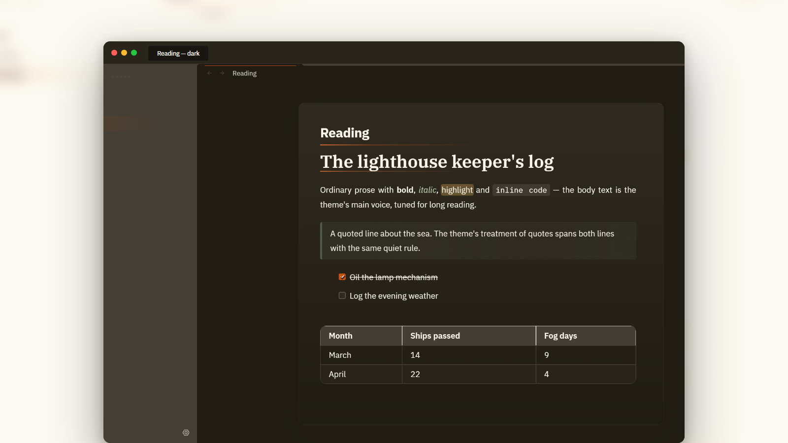
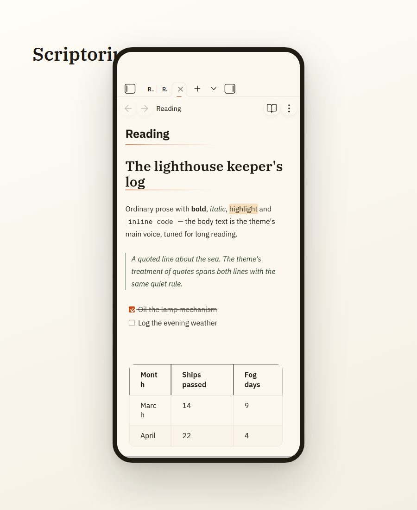

# Scriptorium 主题

_一张安静的书桌。_

[English](./README.md) | [Japanese](./README.ja.md)

  
  
  

一款温暖、简洁的 Obsidian 主题，面向长文阅读与写作。

Scriptorium 让正文保持主位：柔和纸色、克制对比、安静的工作区界面、更平的标签与 callout，以及针对中英文混排调过的字体层级。

纸页、光与连接：Scriptorium 与小台灯、技能接线台、比稿（Collate）共享安静的轮廓和视觉节奏。四件产品各自独立，使用主题不需要安装任何插件。

> [!NOTE]
> Scriptorium 是偏个人审美的主题。`Style Settings` 插件中开放了一小组精选控制项；其余一切可调项都在 token 契约里（见 [snippet-example.css](snippet-example.css)）。

## 截图

## 安装

1. 在 Obsidian 社区主题中搜索 `Scriptorium`。
2. 点击“安装并启用”。

手动安装：将 `theme.css` 和 `manifest.json` 放入 `.obsidian/themes/Scriptorium/`，再在“外观 -> 主题”中选择 `Scriptorium`。

## 设计

- Scriptorium 以 IBM Plex 家族排印——安装 [IBM Plex Sans SC](https://fonts.google.com/specimen/IBM+Plex+Sans+SC)（中英混排）、[IBM Plex Serif](https://fonts.google.com/specimen/IBM+Plex+Serif) 与 [IBM Plex Mono](https://fonts.google.com/specimen/IBM+Plex+Mono) 即自动生效；Google Fonts 不可达时可用 [IBM Plex 官方发布包](https://github.com/IBM/plex/releases)。
- 在外观设置里选择自己的字体会领先字体栈，IBM Plex 与中文回退紧随其后。
- 阅读面保持轻：纹理、阴影和强调色都刻意压低。
- 导航、搜索、菜单、标签、callout 和 embed 尽量安静，让正文居中。
- 主题以单一 `theme.css` 发布，无外部依赖。
- 主界面常用图标（快速切换、图谱、日历、白板、数据库、设置、搜索等）与 callout 图标以 Phosphor 线稿绘制；同形图标、插件图标与方向微符保持原生。

## 设计原则

主题按以下原则维护，留作后续修改时的约束：

- 保持暖色纸张配色的克制。
- 表面保持干净：纹理服务于页面，而不是与正文争夺注意力。
- 优先使用排版层级，而非厚重的界面装饰。
- 自动隐藏行为保持有限、可预测，阅读时容易忽略。
- 强调色在正文尺寸的文本中承载语义时，谨慎使用。
- callout、嵌入和浮动 UI 保持同一材质语言，但不让日常操作界面看起来像层叠卡片。
- 标签保持安静：标注正文，而不与标题、链接竞争。
- 阅读舒适优先于装饰新奇。

## 定制

只有两个 opt-in 入口，两者都不装时渲染逐字节一致。

安装 [Style Settings](https://github.com/mgmeyers/obsidian-style-settings) 插件后会出现四个阅读关键项：阅读行宽、正文行高、段落间距、标题字体。默认值与主题自身数值相同。

按文件的 helper classes 写进 `cssClasses` frontmatter，可自由组合：

| 类名 | 效果 |
| --- | --- |
| `cards` | Dataview 表格变卡片网格（`cards-cols-1/3/4` 固定列数） |
| `row-lines` / `col-lines` / `table-lines` | 单元格边线：行、列、全网格 |
| `row-alt` | 表格隔行条纹 |
| `table-tabular` | 数字列用等宽数字 |
| `table-nowrap` | 单元格不换行 |
| `table-fixed` | 等宽列 |
| `table-compact` | 更小更紧的表格 |
| 任务语法 `[!]` `[?]` `[>]` `[-]` | 语义复选框：琥珀、苔绿、铜橙、删除线淡墨——阅读与实时预览都生效 |

## 插件适配

只做结构性对齐——[Dataview](https://github.com/blacksmithgu/obsidian-dataview)、[Tasknotes](https://github.com/alangrainger/obsidian-task-notes)、[Quiet Outline](https://github.com/guopenghui/obsidian-quiet-outline) 和 [Advanced Table Editor](https://github.com/dromar56/obsidian-advanced-table-editor) 的面板与卡片继承主题的表面与边线，不重新着色、不重新排版。

## 开发

可读源码在 `src/theme.css`。修改后运行 `npm run build`，由 esbuild 压缩生成发布的 `theme.css`，保持文件轻量以通过社区商店的体积检查。`npm run lint` 对源码运行 stylelint。

个人微调走 CSS snippet——[snippet-example.css](snippet-example.css) 是一份带注释的 token 导览：哪些变量可以放心覆盖、色阶斜坡怎么重调、三层覆盖关系，都在里面。

由 [@ouatis](https://github.com/ouatis/) 制作。受 [Sanctum](https://github.com/jdanielmourao/obsidian-sanctum) 与 [Baseline](https://github.com/aaaaalexis/obsidian-baseline) 启发。
